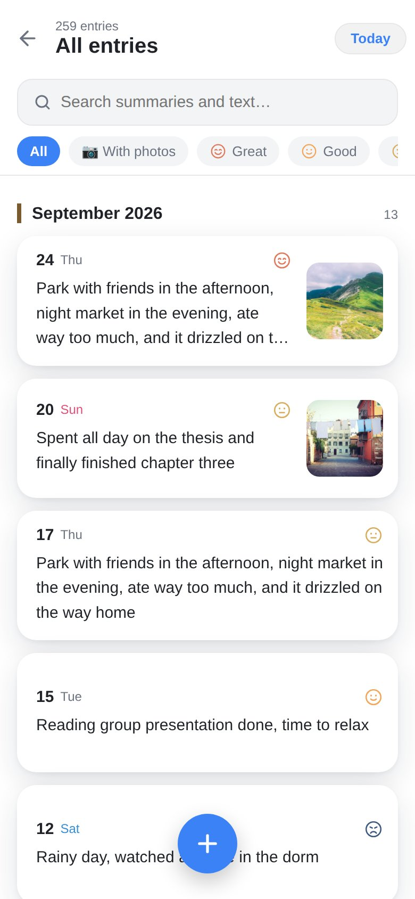
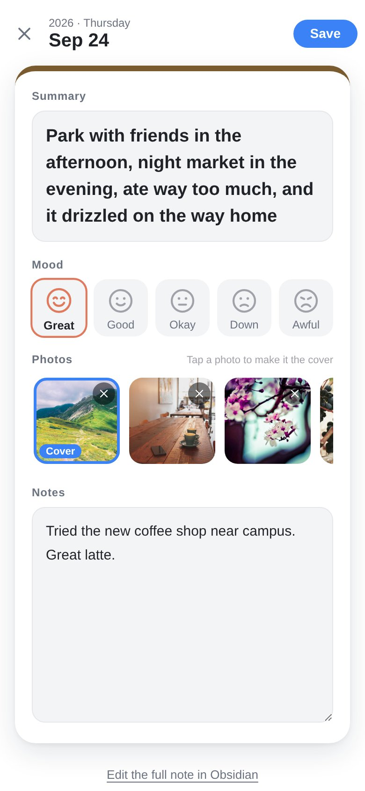

# Diary Cards

English | [繁體中文](README.zh-TW.md)

An Obsidian plugin that turns your daily notes into cards. Works on desktop and mobile.

<p>
  
  
  
  
  
</p>

## Features

- **Year**: swipe through 12 month cards. Dots mark the days you wrote. Below, a grid shows every day of the year colored by mood (mood is optional), and the top corner shows how many days in a row you've written.
- **Month**: a photo calendar (days with photos show their cover) and a card for each entry. Tap an empty day to fill it in. Swipe the calendar, use the ‹ › buttons or the month rail to change months.
- **Entry**: summary, mood, photos and the note body rendered by Obsidian. Page to the previous or next entry.
- **All entries**: a timeline grouped by month. Search summaries and text, or filter by photos or mood.
- **Month covers**: pick any photo from that month as its cover, or let it use the latest entry with a photo.
- **Quick entry**: write a one-line summary, pick a mood, add photos (tap one to make it the cover) and notes. Switch to the full Obsidian editor for longer writing.
- **Photos are made smaller**: new photos are resized to 2048 px and saved as JPEG, which also drops location (GPS) data. Formats the device can't decode, such as some HEIC files, are saved unchanged.
- The interface follows Obsidian's language: English, Traditional Chinese or Simplified Chinese.

## Your notes

Diary Cards reads notes whose file name is a date. On first install it uses the folder, date format and template from Obsidian's built-in **Daily notes** plugin. You can change them in the plugin settings:

| Setting | Default | |
|---|---|---|
| Diary folder | *(whole vault)* | Only notes in this folder and its subfolders are read. |
| Date format | `YYYY-MM-DD` | Moment.js format. It can include folders, e.g. `YYYY/MM/YYYY-MM-DD`. |
| Summary property | `summary` | Shown on the cards. Entries without it show their first paragraph. |
| Mood property | `mood` | A number from 1 to 5. |
| Template | *(built-in)* | Supports `{{title}}`, `{{date}}`, `{{time}}` and `{{date:FORMAT}}`, like Daily notes. |
| Put new entries in year folders | off | Creates new entries at `Folder/2026/2026-09-24.md`. Ignored when the date format already has folders. |
| Open to | This month's calendar | Or the year page, or wherever you left off. |
| Mood colors | Warm to cool | Also Vivid, Soft, or Single color (follows your accent color). |
| First day of the week | *(follows the language)* | Sunday or Monday. |

A note looks like this:

```markdown
---
summary: Barbecue with the lab juniors
mood: 4          # 5 great, 4 good, 3 okay, 2 down, 1 awful
cover: bbq.jpg   # optional; defaults to the first image in the note
---

Anything you like, in Markdown. Images in the note become the entry's photos.
```

Diary Cards only changes a note when you save it from the quick entry screen. It updates the summary, mood and cover properties and the note body, and leaves other properties alone. A new entry starts from your template, and what you write is added after the template's text.

## Installing

In Obsidian, open *Settings → Community plugins → Browse*, search for **Diary Cards**, then install and enable it. Requires Obsidian 1.8.7 or later.

To try changes before they reach the plugin list, install it with [BRAT](https://github.com/TfTHacker/obsidian42-brat) (add `YuunJiee/diary-cards`). You can also install it manually: download `main.js`, `manifest.json` and `styles.css` from the [latest release](https://github.com/YuunJiee/diary-cards/releases) into `<vault>/.obsidian/plugins/diary-cards/`.

Open it from the ribbon icon or the command palette (**Diary Cards: Open**). Links to `obsidian://diary-cards` open it too, and `obsidian://diary-cards?write=today` starts today's entry.

## Development

```bash
npm install
npm test           # tests for summaries, frontmatter and date formats
npm run dev        # rebuild main.js on change
npm run preview    # build a browser preview, then open preview/index.html
                   # (?screen=year|month|entry|all|edit, ?lang=en|zh-CN,
                   #  ?palette=classic|soft|mono, ?week=monday, ?photos=1, #dark)
node preview/fetch-photos.mjs   # photos for ?photos=1 (used for the README screenshots)
VAULT=/path/to/vault npm run install-vault
```

To release: `npm version patch` (or `minor`/`major`) updates `manifest.json` and `versions.json` and creates the tag; `git push --follow-tags` makes GitHub Actions build a draft release.

## Acknowledgements

Diary Cards is inspired by [Oak Diary](https://www.oakdiary.com/) (Card Diary on iOS) by Oak Studio. It is an independent project and is not affiliated with or endorsed by Oak Studio.

Screenshot photos are from [Unsplash](https://unsplash.com/) via [Lorem Picsum](https://picsum.photos/), used under the Unsplash License.

## License

[MIT](LICENSE)
