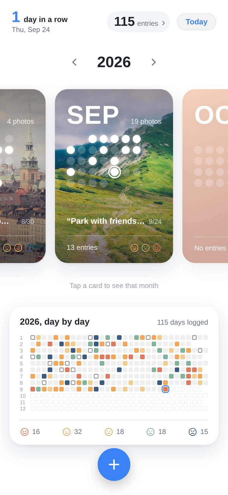
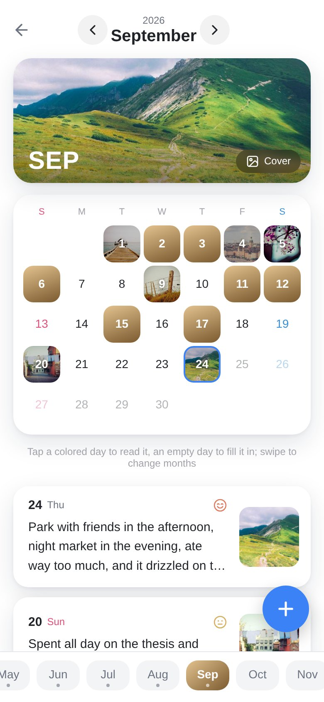
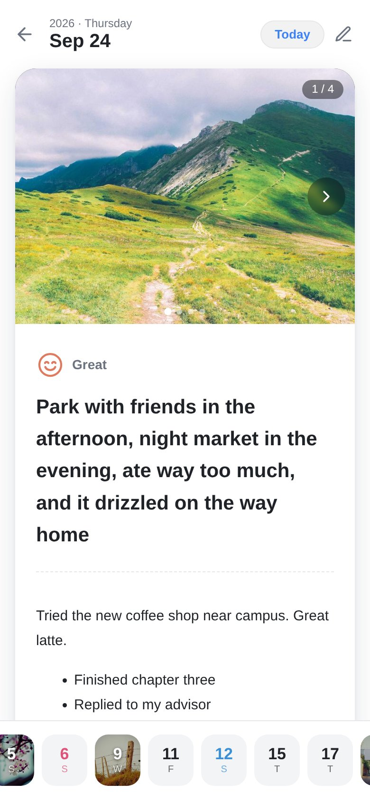
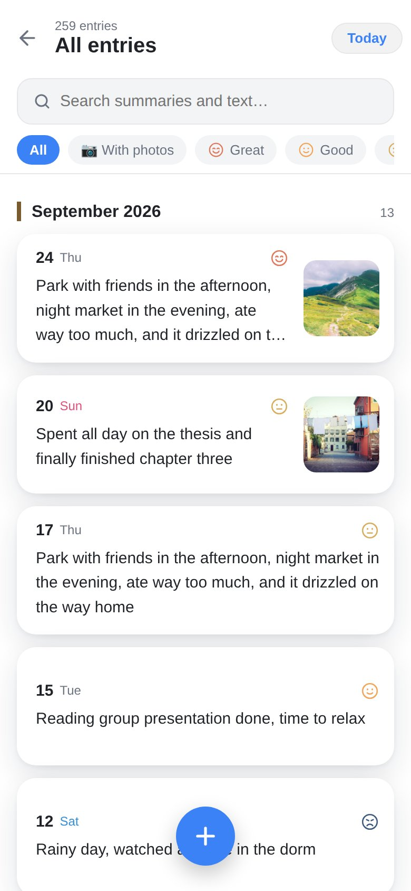
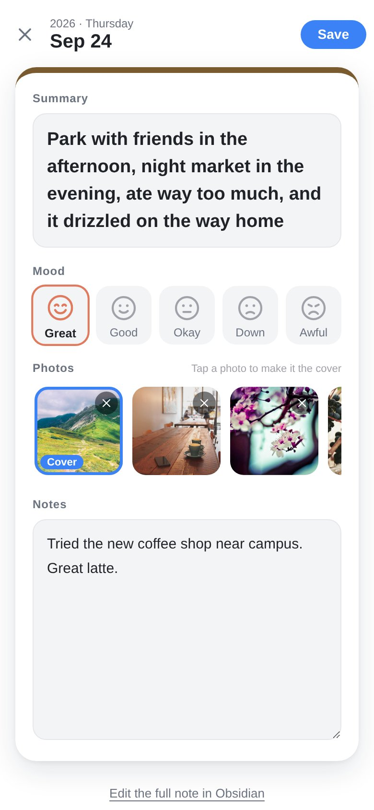

# Diary Cards（日記卡片）

[English](README.md) | 繁體中文

把 Obsidian 的每日日記呈現成卡片的外掛，手機和電腦都能用。

<p>
  
  
  
  
  
</p>

## 功能

- **年份頁**：12 張月份卡片左右滑，小點點標出有寫日記的日子。底下的格子圖列出一年的每一天，用顏色標出心情（心情可以不填），左上角顯示連續記錄了幾天。
- **月份頁**：照片月曆（有圖的日子直接顯示封面）和每天的日記卡片，點空白的日子可以補寫。可以在月曆上左右滑、用標題列的 ‹ ›，或底部的月份滑軌換月。
- **單篇頁**：一句話、心情、照片，以及用 Obsidian 渲染的內文，可以翻前一篇／下一篇。
- **所有日記**：點年份頁右上的「N 篇」，按月份分段的時間軸，可以搜尋一句話和內文，篩選有照片或某個心情的日記。
- **每月封面**：從那個月的照片裡選一張當封面；沒選就用最新一篇有圖的日記。
- **快速記錄**：寫一句話、點選心情、加照片（點照片設成封面）和內文；要寫長文可以切到 Obsidian 的編輯器。
- **照片會縮小**：新加的照片會縮到長邊 2048 px、存成 JPEG，順便拿掉位置（GPS）資訊。手機解不開的格式（例如部分 HEIC）會存原檔。
- 介面跟著 Obsidian 的語言，顯示英文、繁體中文或簡體中文。

## 日記格式

Diary Cards 會讀檔名是日期的筆記。第一次安裝時，資料夾、日期格式和範本會沿用 Obsidian 內建「日記」外掛的設定，之後可以在外掛設定裡改：

| 設定 | 預設 | |
|---|---|---|
| 日記資料夾 | （整個 vault） | 只讀這個資料夾（含子資料夾）裡的筆記。 |
| 日期格式 | `YYYY-MM-DD` | Moment.js 語法，可以含資料夾，例如 `YYYY/MM/YYYY-MM-DD`。 |
| 「一句話」欄位 | `一句話` | 顯示在卡片上；沒填的日記會顯示內文第一段。英文介面的預設是 `summary`。 |
| 「心情」欄位 | `心情` | 1～5 的數字。英文介面的預設是 `mood`。 |
| 日記範本 | （內建） | 支援 `{{title}}`、`{{date}}`、`{{time}}` 和 `{{date:格式}}`，跟內建「日記」外掛一樣。 |
| 新日記放進年份資料夾 | 關 | 新日記建立在 `資料夾/2026/2026-09-24.md`。日期格式已經有資料夾時不會再多加一層。 |
| 打開時顯示 | 這個月的月曆 | 也可以選年份頁，或上次停留的畫面。 |
| 心情配色 | 暖到冷 | 另外有繽紛、柔和、單色（跟著主題色）。 |
| 一週的第一天 | （跟著語言） | 星期日或星期一。 |

一篇日記長這樣：

```markdown
---
一句話: 晚上和實驗室學弟妹們去吃烤肉
心情: 4          # 5 很棒、4 不錯、3 普通、2 低落、1 很糟
cover: 烤肉.jpg  # 選填，不填就用內文第一張圖
---

想寫什麼都可以，支援 Markdown。內文裡的圖片就是這篇的照片。
```

沒填「一句話」的日記，卡片上會顯示內文的第一段（跳過標題、圖片和沒填的範本欄位；清單項目用「·」串起來）。

Diary Cards 只有在快速記錄畫面按下儲存時才會修改筆記：更新一句話、心情、封面這幾個欄位和內文，其他欄位不動。新日記會先套用範本，你寫的內容接在範本內文後面。

## 安裝

在 Obsidian 打開「設定 → 第三方外掛 → 瀏覽」，搜尋 **Diary Cards**，安裝後啟用。需要 Obsidian 1.8.7 以上。

想搶先試用還沒上架的新版，可以用 [BRAT](https://github.com/TfTHacker/obsidian42-brat) 安裝（加入 `YuunJiee/diary-cards`）。也可以手動安裝：從[最新版本](https://github.com/YuunJiee/diary-cards/releases)下載 `main.js`、`manifest.json`、`styles.css`，放進 `<vault>/.obsidian/plugins/diary-cards/`。

從左側的圖示或命令面板（**Diary Cards: 打開**）打開。筆記裡的 `obsidian://diary-cards` 連結也能打開，`obsidian://diary-cards?write=today` 會直接開始寫今天的日記。

## 開發

```bash
npm install
npm test           # 內文摘要、frontmatter、日期格式的測試
npm run dev        # 監看並重新打包 main.js
npm run preview    # 打包瀏覽器預覽，然後打開 preview/index.html
                   # （?screen=year|month|entry|all|edit、?lang=en|zh-CN、
                   #   ?palette=classic|soft|mono、?week=monday、?photos=1、#dark）
node preview/fetch-photos.mjs   # 下載 ?photos=1 用的照片（README 截圖用）
VAULT=~/MyVault npm run install-vault   # 打包並複製到 vault
```

README 的截圖是預覽頁的英文畫面（`?lang=en&photos=1`，390×844、2 倍解析度），放在 `docs/`。

發版：

```bash
npm version patch      # 或 minor／major：更新 package.json、manifest.json、versions.json 並打 tag
git push --follow-tags # GitHub Action 會打包並建立 Release 草稿，確認後再發布
```

## 致謝

Diary Cards 的靈感來自 Oak Studio 的 [Oak Diary](https://www.oakdiary.com/)（iOS 版名稱為 Card Diary）。本專案是獨立開發的，跟 Oak Studio 沒有任何合作或授權關係。

截圖裡的照片來自 [Unsplash](https://unsplash.com/)（透過 [Lorem Picsum](https://picsum.photos/)），依 Unsplash License 使用。

## 授權

[MIT](LICENSE)
